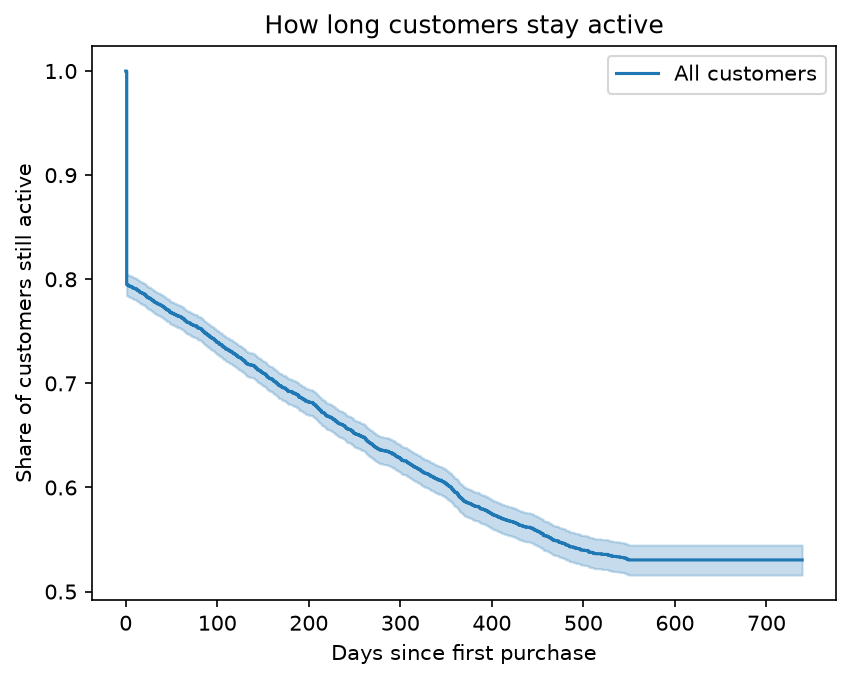
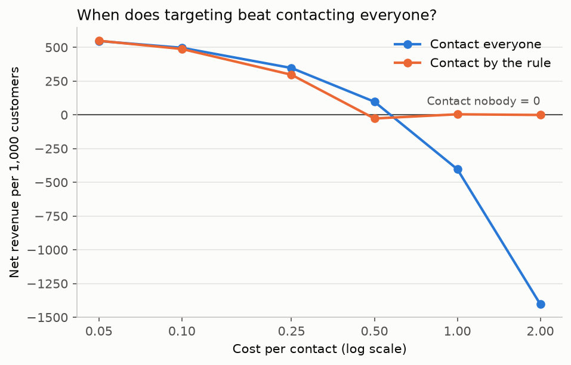

# Retention Decision Engine

Working out which customers are actually worth trying to keep, using real retail purchases and a randomized email experiment.

[](https://retentiondecisionengine-flqqe6sahd9hrqm5qs8v8j.streamlit.app)

**Live dashboard: https://retentiondecisionengine-flqqe6sahd9hrqm5qs8v8j.streamlit.app** (if it shows a "wake up" button, click it; free apps sleep when idle)

## The question

A retention team cannot contact every customer, and contacting some of them is wasted money (they would have stayed anyway). A plain "who will churn" model does not answer that. This project asks a more useful question: **who is worth contacting, and is it worth the cost?**

It has four parts:

1. **SQL (PostgreSQL):** clean the transactions, measure retention, and decide what "churned" means.
2. **Survival analysis:** estimate how long customers stay active, and what changes that.
3. **Customer value and uplift:** predict what a customer is worth over the next 180 days, and measure what an email actually changes using a randomized experiment.
4. **A decision rule:** contact a customer only if the extra money expected is more than the cost, then check that rule against the randomized data.

## Main findings

| Question | Result |
|---|---|
| How concentrated is revenue? | The top 10% of customers bring in 63.9% of revenue; the bottom half bring in about 6.5%. |
| How long do customers stay? | 74.6% are still active at 90 days, 69.2% at 180 days, and 59.0% at one year. |
| What predicts leaving? | Customers whose first order was larger stay longer (hazard ratio 0.76 per log unit, 95% interval 0.73 to 0.80). UK vs non-UK makes no detectable difference (0.93, interval 0.80 to 1.08). First-order information on its own is a weak predictor (concordance 0.58). |
| Can we predict future value? | The model predicts who buys again within 180 days well (AUC 0.80, every customer scored out-of-fold). It ranks customers by future revenue a little better than past revenue (rank correlation 0.62 vs 0.57), but is no better at finding the very top spenders (62.7% vs 62.3% of future revenue in the top 10%). |
| Does an email work? | Yes. Site visits rose from 10.6% to 16.7% (+6.1 points, 95% interval 5.5 to 6.6) in a randomized experiment of 64,000 customers. |
| Can a model find who responds most? | Partly. Emailing the top 30% by predicted response gave about 27% more extra visits per email than emailing everyone, but the ranking was not reliable at the bottom, and purchases were too rare (0.9%) to model directly. |
| Does model-based targeting beat a simple rule? | Not in this data. Contacting everyone is profitable until a contact costs about 0.60 (the average extra spend per email). Above that, the decision rule's value is mainly in knowing when not to contact: at a cost of 1.00 contacting everyone loses 403 per 1,000 customers, while the rule ends up near zero. Between 0.05 and 0.25 there was no measurable difference between the rule and contacting everyone. |




## Data

- **UCI Online Retail II:** about 1.07 million purchase lines from a UK online gift retailer, December 2009 to December 2011. Not included in this repo; download it from the UCI Machine Learning Repository and check that page for the licence and citation. The data has no currency sign; the shop is in the UK, so amounts are probably pounds.
- **Hillstrom email experiment:** Kevin Hillstrom's MineThatData E-Mail Analytics and Data Mining Challenge (2008). 64,000 customers were randomly sent a men's email, a women's email, or nothing, with visit, conversion and spend recorded for two weeks. Not included in this repo.
- The two datasets are different people. The decision rule is demonstrated on the email experiment, and it is not a claim about the retail customers.

## What was done

**SQL (PostgreSQL)**
- Converted the two-sheet Excel file to one CSV with pandas and loaded all 1,067,371 rows into a staging table with every column as text.
- Cleaned it to 805,549 rows and 5,878 customers by dropping rows with no customer ID, cancellations, and non-positive quantities or prices.
- Monthly revenue, top customers, and cohort retention. Retention stays in the mid-30s to low-40s per cent after the first month, because customers go quiet and come back later, especially around Christmas.
- **Churn definition:** compared "no purchase for 90 days" (50.9% of customers) with "180 days" (40.8%). A gap analysis with `LAG` showed that 93% of purchase gaps are 180 days or shorter, so I chose 180 days.
- RFM segments (Champions, Loyal, Developing, At Risk, Hibernating) saved as a view, plus indexes and a primary key.

**Survival analysis (Python, lifelines)**
- Customers who have not yet churned are treated as censored, so they still count for the time they were observed.
- Kaplan-Meier curves overall and by first-order size and country, and a Cox model using only facts known at the first order. Total orders and total spend are not used because they are only known after the customer finishes, which would leak the answer.

**Customer value**
- A snapshot at 9 June 2011: features use only purchases before that date, and the outcome is revenue in the following 180 days.
- Expected value = probability of buying again × expected spend if they do, from gradient boosting models with 5-fold cross-fitting.

**Uplift and decision rule**
- A T-learner with cross-fitting on the Hillstrom experiment, predicting the chance of a site visit with and without an email.
- Decision rule: contact if predicted uplift × revenue per extra visit is more than the cost per contact. Revenue per extra visit (about 9.80) comes from the experiment itself.
- Because assignment was random, the rule is checked by comparing emailed and not-emailed customers inside the group the rule selects, with a bootstrap 95% interval.

## Repository contents

```
queries.sql                  all SQL, in the order it was run
convert_excel_2_csv.py       converts the two-sheet Excel file into one CSV
connect.py                   checks the Python connection to PostgreSQL
survival_analysis.py         Kaplan-Meier curves and Cox model
clv_model.py                 180-day customer value model
uplift_model.py              uplift model on the Hillstrom experiment
decision_rule.py             contact-or-not rule and its check
export_dashboard_data.py     writes the small summary files the dashboard reads
dashboard/                   Streamlit app and its summary files
docs/figures/                charts
docs/retention-sql-notes.md  notes and results for each SQL step
```

## How to reproduce

1. Download Online Retail II and convert it to one CSV (edit the two paths at the top of `convert_excel_2_csv.py`).
2. Create a PostgreSQL database called `churn`, create `raw_retail`, import the CSV, and run `queries.sql` in order.
3. Create a virtual environment and install `sqlalchemy psycopg2-binary pandas lifelines matplotlib scikit-learn scipy streamlit plotly`.
4. Set your database password in the `PGPASSWORD` environment variable, then run `survival_analysis.py` and `clv_model.py`.
5. Download the Hillstrom CSV into `data/hillstrom.csv`, then run `uplift_model.py` and `decision_rule.py`.
6. Run `export_dashboard_data.py`, then `streamlit run dashboard/app.py`.

## Limitations and assumptions

- Churn is defined as no purchase for more than 180 days, counted from the last date in the data (9 December 2011). That is a judgement call. The gap analysis supports it but cannot prove it, because it only sees customers who came back.
- The survival curves go flat after about 550 days partly because of this definition: a customer is only counted as churned if their last purchase was at least 180 days before the end of the data. It does not mean long-standing customers never leave.
- The first cohort (December 2009) includes customers who were already buying before the data starts.
- Revenue figures are revenue, not profit. "Net" in the decision rule means extra spend minus contact cost.
- Only about 1% of customers in the email experiment bought, so purchases were too rare to model directly. The uplift model predicts site visits, and one average revenue-per-visit figure is used for everyone.
- The uplift model's predicted lift is larger than the real lift at the top, so its ordering is more trustworthy than its size, and its ranking was not reliable at the bottom.
- The retail customers and the email-experiment customers are different people.
- This is one UK gift retailer with many wholesale buyers, and one email campaign. Results may not carry over to other businesses.
- RFM cut-offs are my own choices. RFM computed at the end date describes customers but cannot predict churn, because recency would give the answer away.

## Tools

PostgreSQL and pgAdmin, SQL (CTEs, window functions, views), Python (pandas, lifelines, scikit-learn, SQLAlchemy), Streamlit and Plotly.
